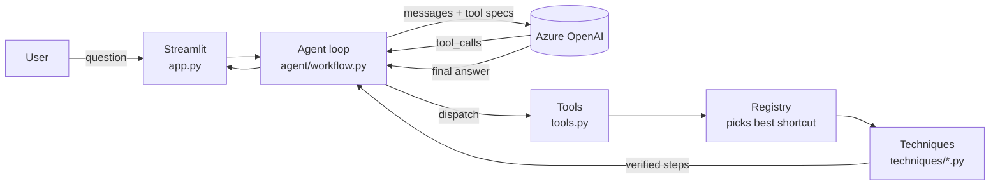

# Quick Math Coach

A chatbot that teaches mental-math shortcuts. It demonstrates how to combine an
**LLM agent loop** with **tool calling**: the LLM understands the question and
explains the answer, while deterministic Python tools do (and verify) the maths.

## Architecture



| Layer | File | Responsibility |
|---|---|---|
| Techniques | `src/quickmath/techniques/` | One class per shortcut: when it applies, and its steps. Every result is checked against plain arithmetic. |
| Registry | `src/quickmath/registry.py` | Finds the applicable techniques and ranks them by `priority`. |
| Tools | `src/quickmath/tools.py` | Exposes the registry to the LLM as two function-calling tools: `solve_with_shortcut` and `list_shortcuts`. |
| Agent | `src/quickmath/agent/workflow.py` | The loop: call LLM, run requested tools, feed results back, repeat until the LLM answers (max 5 rounds). Yields events so the UI can show each step. |
| UI | `app.py` | Chat interface with a live, collapsible agent trace. |

**Who decides what.** The LLM only turns the question into `(a, operation, b)`, or
`(first, "series", last, step)` for a sum like `1 + 2 + … + 100`.
Choosing the shortcut is done in Python, so the agent cannot pick a trick that
doesn't apply or invent arithmetic.

## Setup

```bash
py -3.11 -m venv .venv
.venv\Scripts\activate
pip install pip-tools
pip-sync requirements.txt
cp .env.example .env   # then fill in your Azure OpenAI (or OpenAI) settings
```

Change dependencies by editing `requirements.in`, then run `pip-compile --strip-extras requirements.in && pip-sync requirements.txt`.

## Run

```bash
streamlit run app.py
pytest                # offline: uses a fake LLM, no API calls
```

## Chat logs and feedback

Every chat is saved to `logs/<date>-<time>-<id>.json` (git-ignored; change the folder with
`QUICKMATH_LOG_DIR`). The sidebar shows the current file. Each turn records the question, the tool
calls with their results, the answer (or error), and any 👍/👎 rating with a note left under the answer.
The file also records the model and the git commit, since prompts and shortcuts change over time.

To report a problem, rate the answer and write what should change, then point Claude Code (or anyone)
at the file, e.g. *"see the 👎 feedback in logs/20261010-195851-a1b2c3.json"*.

## Adding a shortcut

1. Create `src/quickmath/techniques/<name>.py` with a `@register`ed `Technique` subclass
   (see `add_9.py`): set `name`, `title`, `rule`, `operation`, `priority`, and implement
   `_applies()` and `steps()`.
2. Import it in `src/quickmath/techniques/__init__.py`.
3. Add tests. A Hypothesis test comparing against plain arithmetic catches most mistakes.

The tool specs, agent and UI pick it up automatically.
